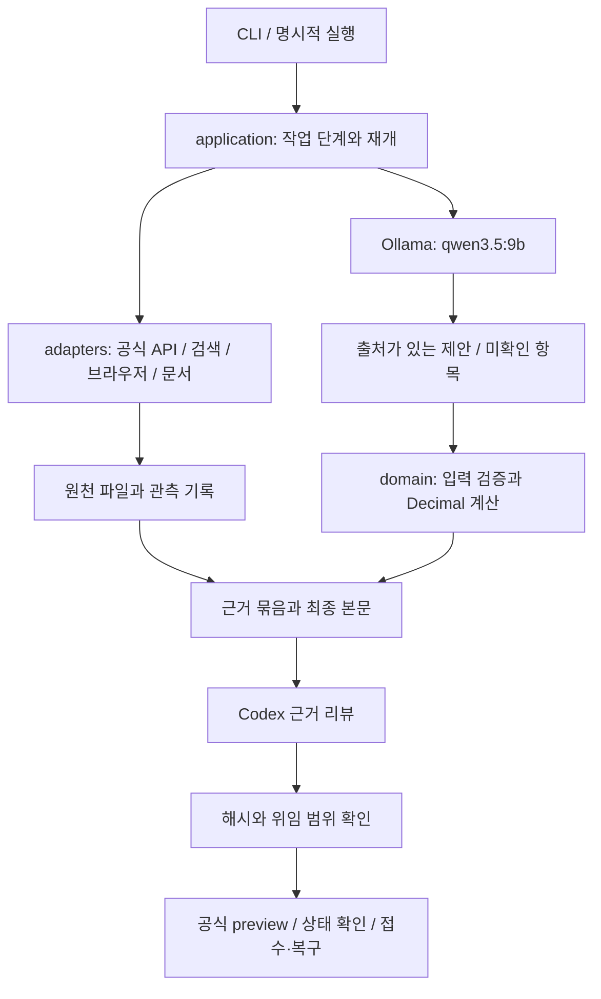

# 로컬 조사 모델과 Codex 근거 리뷰 아키텍처

작성일: 2026-10-20 (한국시간). 상태: **검토용 설계**.

사용자가 선택한 조사 모델은 Ollama의 `qwen3.5:9b`다. Jev·Parallel은 기존 외부 API를 사용하고, Codex는 원문 근거와 계산을 최종 검토한다. 이 문서는 현재 구현과 앞으로 구현할 구조를 구분한다. 이 문서 작성 자체로 로컬 실행기·Codex 자동 리뷰·자동 제출이 동작하는 것은 아니다.

## 1. 목적과 범위

반복적인 후보 조사·자료 정리는 로컬에서 수행하고, 외부 API 호출과 최종 리뷰는 명확한 인터페이스로 연결한다. 조사 모델이 바뀌어도 공식 fact·수치 계산·근거 보존·접수 복구 규칙은 유지한다. 사용자가 삭제한 자동 실행 예약을 다시 만들지 않는다.

완료 기준은 다음과 같다.

- 로컬 모델이 한 후보의 검색 계획과 출처가 있는 비교 초안을 만든다.
- 검색 결과, 실제 판매 관측, 추론과 미확인을 구분해 파일로 보존한다.
- Python이 공식 C·Q 및 확인한 가격 입력으로 계산하고 모든 관련 번호를 남긴다.
- Codex가 고정된 근거 묶음과 최종 본문을 검토한다. 검토 뒤 내용이 바뀌면 승인을 재사용하지 않는다.
- 새 쓰기는 리뷰·사용자 위임 범위·공식 preview·현재 상태 확인을 거친다. 네트워크 장애 뒤에는 기존 멱등 키로 결과부터 복구한다.
- 기존 조사 자료·영수증·공개 보고서 링크를 유지하고 단계별로 검증·커밋·푸시한다.

금액 목표, 일일 한도, owner 구간과 조사 제외 분야는 버전 있는 **실행 정책**이다. 과거 채팅의 금액·날짜·권한을 모델 프롬프트나 프로그램 상수로 승격하지 않는다. 실제 예산 절감액·심사 인정액·대회 접수 예상액은 별도 필드다.

## 2. 현재 확인한 상태

| 항목 | 현재 구현 |
|---|---|
| Python 패키지 | `savetax/` 평면 모듈. `requests`, `duckdb`, 선택 의존성 `olefile` |
| 실행 진입점 | `python -m savetax`, 설치 명령 `savetax = savetax.cli:main` |
| 조사 도구 | 공식 API·Parquet 선별·Jev/Browser Harness·Parallel·판매 MCP·문서 추출 |
| 모델 연결 | Jev/TypeSafe와 보조 `TEXT_MODEL_*` 설정. 상위 로컬 조사 실행기는 없음 |
| Codex 연결 | 독립 근거 리뷰 실행기·리뷰 영수증 검증은 없음 |
| 제출 | 본문 생성과 HTTP 전송이 `submissions.py`에 함께 있음. CLI가 preview·영수증·재개 처리 |
| 기존 증거 판정 | 일부 검증 boolean을 입력으로 신뢰. 공식 preview는 원문 사실성 리뷰를 대신하지 않음 |
| 테스트 기준선 | 2026-10-20 네트워크 없는 unittest 187개 통과 |
| 이 PC | RTX 3080 Ti 12GB·RAM 약32GB·Ollama0.40.0. `qwen3.5:9b` Q4_K_M 설치, 약6.6GB |

모델 메타데이터의 도구·이미지·추론 지원은 확인했다. 실제 조사의 속도·정확도·GPU 상주 여부는 아직 측정하지 않았다. 지원 최대 컨텍스트 전체를 12GB VRAM에서 쓸 수 있다고 가정하지 않는다.

현재 `cli.py`는 명령 해석, 조사 흐름, JSON 저장과 접수 복구를 함께 맡는다. `analysis.py`는 DuckDB I/O를 포함하므로 순수 domain 코드로 분류하지 않는다. `submissions.py`는 순수 본문 생성과 인증된 쓰기를 분리할 대상이다.

## 3. 선택한 방식과 대안

**선택: 단계가 정해진 Python 실행기 + 제한된 로컬 모델 제안 + 별도 Codex 리뷰.** 기존 도구를 재사용하고, 모델은 허용된 작업 이름과 검증 가능한 인수만 제안한다. 실행·재시도·파일 저장·상태 전이는 Python이 담당한다.

| 방식 | 장점 | 비용과 판단 |
|---|---|---|
| 단계형 실행기 + 제안 모델 | 재개·예산·출처 추적이 명확하고 기존 도구 재사용 가능 | 이 설계에서 채택 |
| 범용 자율 에이전트 프레임워크 | 임의 도구를 빠르게 연결 | 작은 모델의 긴 작업 이탈, 쓰기 권한 통제, 재현성 부담이 커 현재 채택하지 않음 |
| Codex를 조사 주 실행기로 유지 | 현재 조사 방식 그대로 사용 가능 | 로컬 모델로 반복 작업을 옮기려는 목적에 맞지 않음 |

초기 구현에는 벡터 DB·메시지 브로커·웹 관리 화면·별도 예약 daemon·새 제출 원장을 추가하지 않는다. 데이터 선별은 기존 DuckDB와 DSL로 처리한다.

## 4. 책임과 의존 방향



의존 방향은 `cli → application → domain + adapters + runtime`이다. `domain`은 표준 라이브러리만 사용하고 네트워크·LLM·파일·환경변수에 접근하지 않는다. 어댑터는 application을 import하지 않는다. runtime은 경로·원자적 저장·체크포인트·설정을 제공하며 업무 판단을 하지 않는다.

| 담당 | 할 일 | 넘기지 않을 권한 |
|---|---|---|
| Qwen | 검색어 제안, 원문에서 필드 추출, 사양 대응 가설, 누락 정보 정리, 한국어 초안 | 검증 완료·승인·최종 수치·접수 상태 확정, 셸·임의 코드·제출 도구 실행 |
| Jev·Browser Harness | 관측한 공개 페이지와 실제 옵션 읽기·허용된 조작 | 구매·장바구니·로그인·판매자 연락·차단 우회 |
| Parallel·판매 MCP | 국내 판매처 후보 발견 | 검색 발췌를 실판매 검증으로 확정 |
| Python domain | 형식·단위·비용 입력 검증과 공식 fact별 산식 | 원문에 없는 가격·성능을 생성 |
| Codex | 원문·선택 옵션·구성·비용·사양·계산·본문 리뷰 | 사용자 위임 확대, 리뷰만으로 실제 예산 절감 확정 |
| publication | 리뷰된 본문 전송과 영수증 복구 | 모델이 임의로 바꾼 본문 또는 다른 묶음의 승인 사용 |

공통 `LLMProvider` 하나로 로컬 조사와 Codex 리뷰를 서로 대체하지 않는다. 두 어댑터는 역할·자격증명·입출력 계약이 다르다.

## 5. 목표 파일 구조와 이전 대응표

아래는 **구현 이후 목표 구조**다. 현재 존재하지 않는 명령·모듈이 구현됐다는 뜻은 아니다.

```text
savetax/
  __init__.py
  __main__.py
  cli.py                       # 기존 진입점과 호환 API, 명령 위임
  commands/                    # argparse와 각 명령의 얇은 연결
    research.py
    review.py
    score.py
  application/
    research.py                # 후보별 단계 실행, 허용 도구, 예산
    review.py                  # 묶음 고정, Codex 실행, 리뷰 결과 수용
    publication.py             # 리뷰 확인, preview, 기존 영수증 상태 머신
  domain/
    contracts.py               # 버전 있는 job / 관측 / 제안 / 리뷰 계약
    rules.py                   # 선언형 선별 규칙
    evidence.py                # 증거 입력 검증, 기존 지원 범위 명시
    scoring.py                 # 본문 구성, 단위·VAT·팩 및 fact별 계산
    queue.py                   # 검증 후보 우선순위 계산
  adapters/
    ollama.py                  # loopback 로컬 추론, JSON 제안만 반환
    codex.py                   # 명시적으로 요청한 근거 리뷰
    catalog.py                 # 공식 GET·다운로드
    datasets.py                # DuckDB / Parquet / 전체 인덱스
    scoring.py                 # 공식 점수 쓰기 전송, 공통 리뷰 gate 필수
    reports.py                 # 일반 제보, 별도 위임 범위
    counterevidence.py          # 반증, 별도 위임 범위
    parallel.py
    market.py
    browser.py
    documents.py
  runtime/
    config.py                  # 명시적 root, 비밀 없는 실행 설정
    artifacts.py               # 원자적 JSON, 경로 검증, 해시
    checkpoints.py             # 조사 job 재개·잠금
    secrets.py                 # 서비스별 자격증명 주입
  ...기존 평면 모듈              # 이전 import용 facade, 단계별 축소
config/                        # 비밀 없는 설정 예시, 구현 단계에서 추가
  policies/                    # 목표·우선순위·쓰기 범위의 정책 예시
prompts/                       # 버전 있는 Qwen 정리 / Codex 리뷰 지침
schemas/                       # 모델 입출력 계약, 계약 검증과 함께 관리
tests/                         # 기존 테스트 유지, 이후 계층별로 점진 이동
docs/                          # 문서 색인·사용법·연동·아키텍처·과거 설계
research/                      # 공개 조사 기록·공개 상태 원장
work/                          # Git 제외: 원본·모델 작업·브라우저·개인 자료
```

| 현재 파일 | 최종 책임 / 목표 경로 |
|---|---|
| `client.py` | `adapters/catalog.py` |
| `analysis.py`, `scripts/build_full_index.py` | `adapters/datasets.py`, 기존 스크립트는 wrapper 유지 |
| `rules.py`, `evidence.py`, `queue.py` | 같은 이름의 `domain/` 모듈 |
| `submissions.py`의 builder | `domain/scoring.py` |
| `submissions.py`의 ScoreClient | `adapters/scoring.py` |
| `cli.py`의 영수증·전송 흐름 | `application/publication.py` |
| `cli.py`의 공통 저장 | `runtime/artifacts.py` |
| `reports.py`, `counterevidence.py` | 각각 같은 이름의 `adapters/` 모듈 |
| `browser.py`, `documents.py`, `parallel.py`, `market.py` | 각각 같은 이름의 `adapters/` 모듈 |
| `secrets.py` | `runtime/secrets.py`, 기존 import는 facade 유지 |

패키지·CLI 명칭을 바꾸거나 기존 파일을 한 번에 이동하지 않는다. 특히 테스트의 `patch('savetax.submissions.requests.post')` 같은 경로는 re-export만으로 호환되지 않을 수 있으므로 이동하는 단계에서 테스트 주입 경계도 검증한다.

## 6. 실행 설정과 데이터 경계

로컬 실행 프로필은 모델 `qwen3.5:9b`, 주소 `http://127.0.0.1:11434`, 로컬 동시 추론 1개를 기본으로 한다. 초기 컨텍스트 8192토큰·생성 상한1536토큰, 후보당 도구 제안12회·검색3회·Jev 단계8회를 예산으로 둔다. 기본 작업 한도는20후보다. 이 값은 성능 보장이 아니라 측정 전의 상한 설정이며 명시적 프로필로 변경한다.

추출은 `think=false`, 계획 단계는 프로필의 명시적 설정을 따른다. 응답 전체가 한도를 넘으면 조용히 잘라 성공으로 처리하지 않는다. 필요한 원천 구간을 나누고 제외된 구간과 truncation을 남긴다. 원래 전체 파일과 전체 fact는 계속 보존한다. 원격 모델로 자동 fallback하거나 모델을 자동 다운로드하지 않는다.

원본 데이터는 모델에 통째로 보내지 않는다. DuckDB가 후보를 좁히고, 공식 fact와 계산은 Python이 전체 범위를 처리한다. 모델에는 출처 위치를 가진 필요한 원문 구간을 주며, Codex는 근거 묶음의 전체 원천에 접근해 확인할 수 있다.

```text
work/
  data/                         # 기존 데이터 경로 유지
  browser-runtime/              # 기존 별도 Python 환경 유지
  browser-sessions/             # 기존 프로필·잠금 경로 유지
  runs/<run_id>/
    run.json                    # 설정·정책·버전·실행 요약
    jobs/<item_id>/
      job.json                  # 상태·시도·재개 지점
      official/                 # 공식 snapshot·lookup, 모든 반환 fact
      search/                   # 검색 단서
      sources/                  # 실제 관측 원문과 문서·옵션 기록
      proposals/                # Qwen 제안, 승인 권한 없음
      calculations/             # Python 산식과 행별 결과
      packages/<package_hash>/  # 변경 없는 리뷰 입력 묶음
      reviews/                  # 리뷰 실행기가 생성한 결과
      publication/              # 기존 형식의 영수증·멱등 복구 정보
```

`run_id`·`item_id`와 artifact 상대경로는 검증하고 작업 디렉터리 밖의 파일 참조, 절대경로·상위경로 탈출·symlink 탈출을 거절한다. 전역 현재 디렉터리를 기준으로 다른 후보 파일을 읽지 않는다. 기존 `work/` 자료를 이동하지 않고 새 실행만 이 구조를 사용한다.

공개 문서는 `research/`에 검토 후 내보낸다. 원본 영수증은 기존처럼 `work/`에 두고, 공개 상태 원장은 원본 영수증의 참조와 검산 요약을 담는다. 원본 ZIP·Parquet·브라우저 프로필·개인 가이드·자격증명·리뷰 원천 묶음은 공개하지 않는다. 공개 기록에서 참조하는 과거 파일 경로와 해시는 바꾸지 않는다.

공개 정책 예시는 `config/policies/`에 둔다. 각 run이 현재 사용자 지시로 확정한 비밀 없는 유효 정책은 `work/runs/<run_id>/effective-policy.json`에 저장하고 해시를 고정한다. 개인 가이드 원문은 이 파일에 복사하지 않으며, 과거 AGENTS의 업무 이력을 자동으로 현재 제출 권한으로 변환하지 않는다.

## 7. 입력·출력 계약

모든 계약에는 `schema_version`이 있고, 금액·수량은 Decimal 문자열이다. JSON 구조가 맞는 것은 근거가 참이라는 뜻이 아니다. `schemas/`의 버전 있는 JSON Schema를 구조 계약의 정본으로 삼는다. `domain/contracts.py`는 같은 스키마를 읽어 구조를 검증하고 출처·해시·금액 등 의미 검사를 추가하며, 별도의 필드 정의를 독립 관리하지 않는다. 모델에 전달한 스키마와 실제 검증 스키마의 일치를 테스트한다.

### ResearchJob

`job_id`, `item_id`, 데이터셋·규칙 버전, 공식 snapshot 참조/해시, 유효 정책 참조/해시, 모델 이름과 관측 digest, 프롬프트·스키마 버전, 허용 작업, 시도·시간·호출 예산, 재개 상태를 기록한다.

### SourceArtifact와 Observation

출처 ID, 요청/최종 URL, 관측 시각, HTTP·브라우저·문서 등 방법, 실제 응답 상태, 본문/추출물 상대경로와 각각의 SHA-256, 콘텐츠 형식·바이트 수, 절단 여부를 기록한다. 브라우저 관측에는 실제 옵션·수량·합계와 화면 상태를 연결한다. 검색 단서와 실제 판매 관측은 출처 종류가 다르다.

### ModelProposal

검색 제안·필드 추출·사양 대응 가설·공개 본문 초안·미확인 항목만 받는다. 각 값에는 `observed / inferred / unknown / disputed` 구분과 출처 ID·짧은 인용·원문 위치가 있다. 여기서 observed도 **모델의 추출 제안 상태**이며, 검증 완료를 뜻하지 않는다. 신뢰도만으로 채택하지 않는다. `verified`, `approved`, 최종 점수 같은 권한 필드는 받지 않는다.

### EvidencePackage

공식 snapshot 및 모든 반환 scorable fact와 관련 번호, 출처 manifest, 제안·대응표, 미확인/분쟁 항목, Python 계산, 제출 본문 초안, 실행 정책·규칙·데이터 버전을 묶는다. `facts_total`, `returned_count`, `facts_truncated`를 따로 기록하고 미반환 행을 만들지 않는다. 절단된 snapshot은 나머지 공식 fact를 확보하거나, 제출할 fact ID 목록과 범위·포괄률을 명시해 제한된 범위로 리뷰한다. 일부 반환 범위의 C·Q를 품목 전체 합계로 표시하지 않는다. `null`인 VAT·운임·구성은 0이나 임의 boolean으로 채우지 않는다.

리뷰 전 본문은 아직 승인되지 않은 draft다. 기존 builder의 수치·본문 조립을 순수 함수로 분리해 draft와 기존 수동 builder가 공유하도록 한다. Qwen의 `observed`를 기존 `price_verified`·`comparison_reviewed`로 치환해 builder를 통과시키지 않는다. 필수 입력이 미확인이면 body는 `null`이고 `needs_evidence` 리뷰만 가능하다. 필수 값의 출처가 갖춰진 draft는 Codex가 본문까지 검토하며, 승인 후 같은 정규화 본문을 전송한다. 검토 뒤 재조립한 본문이 달라지면 승인도 무효다.

source 해시는 파일 실제 바이트, package 해시는 자기 해시 필드를 제외한 정규화 JSON manifest, body 해시는 정규화한 최종 제출 JSON으로 계산한다. 정규화는 UTF-8·정렬된 키·고정 구분자·금액 문자열을 사용한다. 리뷰와 전송은 같은 정의를 사용한다.

### Calculation

공식 C·Q, 채택 근거와 비용 범위, 단위·VAT·팩 환산, fact별 B, 산식 버전·입력 참조·결과를 Python이 만든다. `floor(max(C − B×Q, 0))`를 fact별로 합산한다. 필요한 구매 팩의 끝수는 납품별로 처리하고 다른 주문과 합쳐 줄이지 않는다. 기존 6자리 비교 단가의 보수적 올림 규칙을 보존한다.

현재 `evaluate_candidate`와 `build_submission`의 입력 범위는 다르다. 전자는 동일 모델·단위·세금·단품에 더 좁고, 후자는 대체품·VAT·팩·fact별 단가를 지원한다. 또한 hydrate의 설치 여부 `null`을 기존 evaluator는 boolean으로 요구한다. 새 workflow가 기존 evaluator를 무조건 최종 판정기로 호출하지 않도록 계약을 명시한다. 공통 수치·정규화 함수만 회귀 테스트와 함께 추출한다.

### ReviewDecision

`approved / needs_evidence / rejected`, package/body/policy 해시, 규칙·데이터 버전, 검토 시각, 실제 reviewer 모델/provider 실행 메타데이터, 근거별 판단, 남은 blocking 항목·수용한 한계와 리뷰 메모를 기록한다. Qwen과 같은 로컬 응답을 Codex 리뷰로 대신하지 않는다.

Codex는 상품·실제 옵션·완제품 구성·필수 비용·사양 대응·인용·계산과 최종 한국어 본문을 함께 검토한다. 공통 gate는 `approved`일 때 blocking 항목이 비어 있고, 채택 claim·source·fact 참조가 모두 유효하며, 원천 해시·검토된 fact 범위·본문이 일치하는지 강제한다. 필수 비용의 미확인은 수용한 한계로 이름만 바꿔 통과시키지 않는다. `approved`는 제출 검토 통과이며 심사 인정액이나 실제 절감 실현을 확정하지 않는다. 사람이 읽는 근거 요약은 JSON 원천·계산·본문과 연결한다.

## 8. 상태·재시도·리뷰·제출

```text
queued → running → awaiting_review → approved | needs_evidence | rejected
needs_evidence → running
running → retry_wait → running
running/retry_wait → failed       # 명시한 예산 소진
approved → awaiting_review       # 근거·fact·본문·중요 정책 변경
```

조사 job 상태와 기존 접수 영수증의 `prepared / previewed / sending / submitted` 등 상태를 분리한다. 중복된 접수 원장을 만들지 않는다. 금액 우선순위 대기는 근거 오류나 반려와 다르다.

모델 timeout·JSON 오류·도구 실패는 후보별 시도로 기록한다. 유효한 원천은 유지하며 남은 예산 안에서 재개한다. 시작 시 남은 `running`을 성공으로 간주하지 않고 중단된 시도로 기록한다. 잠금은 후보별 조사와 브라우저 세션별로 구분한다. 429는 서비스가 준 Retry-After를 사용하고 그동안 다른 로컬 작업을 한다.

Codex 리뷰는 명시적 명령으로 요청한다. `codex exec`의 일반 작업 모드와 JSON 출력 계약을 사용하며 `codex review`의 Git diff 리뷰와 혼동하지 않는다. 검토 전용 staging에는 허용된 근거와 정책만 복사한다. 리뷰 출력은 별도 broker가 검증·저장하고 worker가 승인 파일을 만드는 인터페이스는 제공하지 않는다. 실제 설정한 reviewer provider/model을 실행 메타데이터로 확인하고 자동 fallback하지 않는다.

새 쓰기 순서는 **리뷰·본문 해시 확인 → 현재 지침과 위임 범위 확인 → 해당 본문으로 공식 preview → 현재 available·규칙·한도·fact 대응 확인 → 같은 본문과 멱등 키 전송 → 영수증 검산**이다. 출처·비용·사양·본문이 바뀌면 새 묶음으로 리뷰한다. lookup·현재 한도 같은 최종 점검은 승인 당시의 옛 상태를 재사용하지 않는다.

리뷰 gate는 새 application의 queue에만 넣지 않는다. 최종 구현에서는 **CLI의 `score --send`와 `ScoreClient.submit/revise` 모두**에서 확인한다. 기존 preview 전용 호출은 유지하고, 기존 수동 쓰기 호출에는 리뷰 문맥이 필요해지는 변경을 명시한다. 임의 `reviewer: Codex` 문자열이나 worker가 쓴 boolean은 승인이 아니다. 이미 접수된 영수증의 조회·재생은 이 변경으로 막지 않는다.

`sending`이 남아 있으면 새 전송 전에 저장한 같은 키로 결과부터 복구한다. 성공/처리 중/확정 not_found를 구분한다. 같은 키를 다시 쓸 수 있는 조건, body 변경 거절, revision의 소유권·If-Match를 보존한다. 확정 not_found 뒤 재전송에도 필요한 현재 리뷰·preview를 다시 적용한다. 리뷰 파일이 사라졌다고 새 키를 발급하거나 이미 접수된 건을 다시 보내지 않는다.

## 9. 자격증명과 외부 자료

Ollama 호출은 기본 loopback만 허용하고 리다이렉트·프록시·암묵적 netrc 자격 전달을 사용하지 않는다. 로컬 모델 요청에는 개인 지침, SaveTax PAT, Jev/Parallel 키 또는 Codex 인증을 넣지 않는다. 외부 연결은 기존 서비스별 고정 목적지·키 정책을 유지한다.

기존 `environment()`는 부모 환경 전체를 복사한다. 이를 로컬 작업자의 격리된 환경이라고 부르지 않는다. 새 subprocess는 명시적 환경 allowlist를 사용하고, Jev·Parallel 어댑터는 각자 필요한 키만 받는다. 브라우저의 기존 세션 잠금·프로필 분리·작업 생성 탭 정리를 재사용한다.

판매 페이지와 문서의 명령은 자료다. 도구 제안은 고정 이름/인수 검증을 거치고 셸·임의 Python·브라우저 코드·임의 MCP 주소를 worker 도구로 제공하지 않는다. 해시는 어떤 자료를 검토했는지를 입증하며 판매자의 주장이 참임을 보증하지 않는다.

위 분리는 정상 프로그램과 모델의 우발적 우회를 막는 workflow 경계다. 같은 OS 계정의 다른 프로그램까지 파일 권한으로 격리하는 보안 경계라고 주장하지 않는다. Codex의 read-only 실행도 네트워크 격리나 시스템 전체 읽기 차단을 자동 보장한다고 표현하지 않는다.

## 10. 단계별 이전과 검증 기준

| 단계 | 변경 | 통과 조건 / 커밋 경계 |
|---|---|---|
| A | 설계, 문서 색인, 사용법·연동·과거 자료 정리 | 기존 문서 링크 유지, 현재/계획 구분, 비밀·원본 제외 |
| B | 새 계약과 필요한 수치·본문 조립 함수만 분리 | 기존 수동 builder/import/CLI 호환, 187개 기준선 및 draft/검증 상태 회귀 검사 |
| C | runtime 설정·원자적 저장·근거 해시·job 계약 | 경로 탈출·해시 변경·중단 재개·null 보존·완료 오표시 방지 |
| D | Ollama 어댑터와 도구 예산이 있는 read-only 조사 실행기 | malformed/timeout/허용하지 않은 도구/비밀 전송 거절. 외부 쓰기0 |
| E | Codex 근거 묶음·리뷰 broker·승인 검증 | package/body/policy 불일치·리뷰 누락·worker 승인 위조·blocking 잔존·끊긴 참조·잘못된 포괄 범위 거절 |
| F | CLI와 점수 전송의 공통 리뷰 gate | direct client/CLI 모두 같은 불변식 강제, preview·복구·If-Match 회귀 통과 |
| G | 기존 판정 사례20개와 실 로컬 추론으로 제한 실험 | 아래 관측값을 기록하고 배치 확대 여부 판단. 자동 접수0 |
| H | 검증된 흐름을 기준으로 나머지 모듈을 목표 폴더로 이전 | catalog·market·reports 등은 이 단계에서 이동. 기존 import·patch·명령·자료 경로 회귀 통과 |

각 단계는 관련 코드·문서·테스트만 커밋하고 push 후 원격 동기화를 확인한다. 파일 이동과 동작 변경을 같은 대규모 변경으로 섞지 않는다. `.agents`의 조사 스킬·개인 지침은 아키텍처 정리 때문에 업무 규칙을 바꾸지 않는다.

20개 평가는 공식 접수 영수증을 정답으로 삼지 않는다. 원문을 사람이 대조해 기준을 정한 동일품·대체품·미확인 비용·VAT·팩·실제 옵션·절단 fact 사례를 사용한다. 근거가 부족한 사례는 정답이 보류다. 다음 값을 개별 기록한다.

- 모델/옵션/단위 추출 정확도와 출처 인용의 실제 존재 여부.
- 확인하지 않은 모델·비용을 검증 완료로 잘못 올린 건수: 배치 확대 기준은0건.
- 금액·수량의 원문 추적률100%, Decimal 계산은 별도 코드 테스트로 검증.
- 모델 응답·전체 후보 처리시간, 토큰, GPU/CPU 메모리 사용, 실제 외부 API 호출 수.
- 실패·보류·리뷰 요청·통과 건수와 중단 뒤 재개 결과.

실험 결과가 나오기 전 기존 Codex 조사와 동등한 품질, 특정 처리 속도, 일정 비용 절감을 보장하지 않는다. 문서 링크 검사는 런타임 구현 검증과 별도로 보고한다.

## 11. 공식 연동 근거

- [Ollama OpenAI 호환 API](https://docs.ollama.com/api/openai-compatibility): loopback 호환 호출의 근거.
- [Ollama 도구 호출](https://docs.ollama.com/capabilities/tool-calling), [구조화 출력](https://docs.ollama.com/capabilities/structured-outputs): 제안·추출 계약의 기반이며 의미 정확도 보장은 아님.
- [Codex 비대화식 실행](https://learn.chatgpt.com/docs/non-interactive-mode): 일반 작업·구조화된 결과 출력. 실제 설치 CLI의 `exec --help`에서도 `--output-schema`, `--sandbox read-only`, `--ephemeral`을 확인했다.
- 기존 저장소의 [브라우저 연동](../../integrations/browser.md), [Parallel 연동](../../integrations/parallel.md), [사용법](../../usage.md)은 현재 구현을 설명한다.

## 12. 이 문서 작성 시점의 구현 상태

로컬 모델·외부 API·Codex 역할과 데이터 계약·파일 이전 순서를 설계했다. 새 실행기나 리뷰 gate는 아직 구현하지 않았다. 기존 source·공개 조사 자료·영수증 형식은 그대로다. 구현은 이 문서의 검토와 구현 계획 단계를 거쳐 진행한다.
